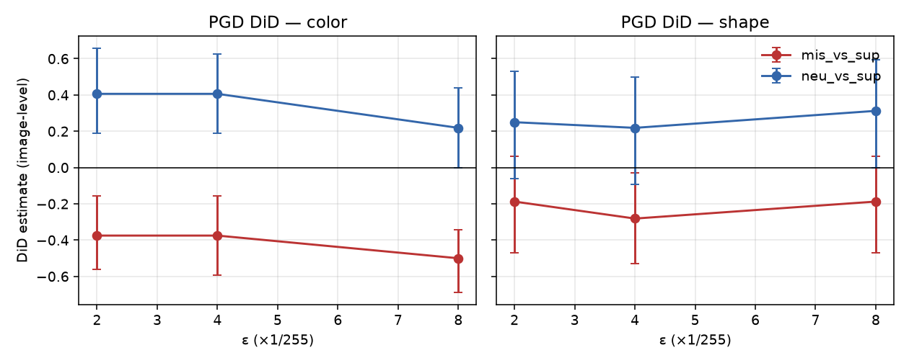
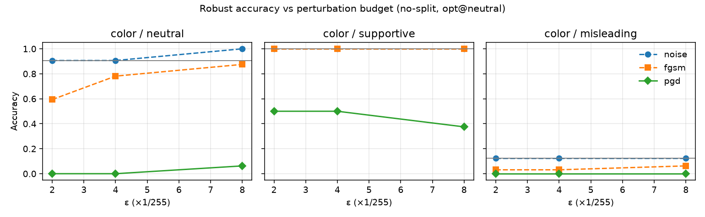
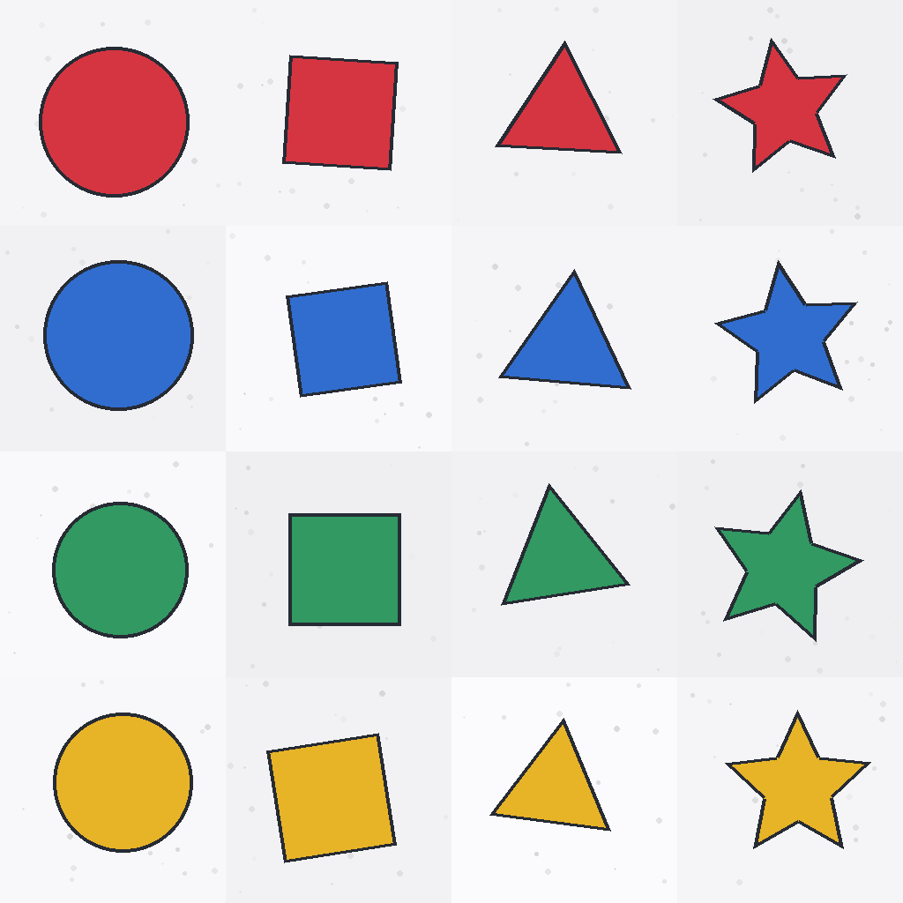

# Cross-modal text context and L∞ image attacks on SmolVLM2

**Question (one paragraph).** On a small synthetic color/shape dataset, does *misleading* textual context make SmolVLM2 *more* susceptible to white-box L∞ image perturbations than *supportive* (truthful) context, when the attack is optimized once under a neutral prompt and the same pixels are evaluated under all three contexts?

**Held-out answer (honest).** On the sealed 32-image test split, the **primary** difference-in-differences (additional error: misleading − supportive) for PGD is **negative for color** at ε ∈ {2,4,8}/255 (e.g. ε=8/255: −0.500, 95% CI [−0.688, −0.344]). That does **not** support the amplification claim. A severe **misleading-color clean floor** (4/32 = 12.5% held-out; 6/64 ≈ 9.4% development) limits identification. A **secondary** contrast (neutral − supportive) is positive for color and shows that context changes vulnerability; it is **not** a validated defense and may partly reflect answer-copying. Full write-up: [`reports/technical_report.md`](reports/technical_report.md). Protocol freeze: [`docs/PROTOCOL.md`](docs/PROTOCOL.md).



*How to read:* for each task, points are image-level DiD estimates vs ε. The mis−sup series below zero for color means *less* additional attack-caused error under misleading than under supportive—opposite of amplification. The neu−sup series above zero means more additional error under neutral than supportive.



*How to read:* solid/dashed curves are post-attack accuracy by context; grey horizontal lines mark clean accuracy. Supportive stays higher under PGD; misleading starts near the floor.

## What this shows vs does not show

| Shows | Does **not** show |
| --- | --- |
| A reproducible no-split MPS attack + paired-context evaluation stack on SmolVLM2 | That misleading text amplifies PGD vs supportive on this benchmark (primary DiD ≤ 0 for color) |
| Held-out confirmation of a development negative primary result under a frozen grid | That supportive captions are a general defense |
| Floor effects, invalid-rate structure, noise≈null / FGSM≪PGD controls | Real-world VLM safety rates, transfer attacks, or SOTA novelty |

**Rigor note.** Primary vs secondary analyses were **frozen after Phase D development and before held-out**—not independently preregistered before all exploration. Chronology and the original hypothesis are preserved; we report the negative primary finding rather than rewriting the question. Historical Phase A–E logs stay immutable.

**Also explicit:** small \(n\) (32 test / 64 dev), many reported cells without formal multiplicity correction, synthetic stimuli only, some non-monotonic ASR vs ε, and **no mechanistic evidence** that supportive text “defends” beyond the paired error contrast (answer-copying is a plausible untested mechanism). Details: technical report §9.

## Quick start (MacBook Air M4, 24 GB; PyTorch MPS)

```bash
python3 -m venv .venv && source .venv/bin/activate
python -m pip install --upgrade pip
python -m pip install -e '.[dev,plot]'
python -m pytest -q
```

### Re-check published statistics on a fresh clone (no GPU, no `results/`)

Committed compact prediction tables + metrics JSON are enough:

```bash
python -m crossmodal_robustness.verify_published
```

This rebuilds accuracy / ASR / additional error / DiD (+ bootstrap CIs) from
`reports/artifacts/*_predictions_compact.jsonl` and compares them to
`reports/phase-e-heldout-metrics.json` and `reports/phase-d-full64-metrics.json`.
Exit code 0 means the published numbers match. **Do not** require gitignored
`results/*.jsonl` for this check.

Dry-run prompts (no weights):

```bash
python -m crossmodal_robustness.evaluate --dry-run --task both --max-examples 2
```

Full held-out **inference** re-run is expensive (~3 h on the recording host) and
was a one-shot under freeze—see [`docs/REPRODUCIBILITY.md`](docs/REPRODUCIBILITY.md).
Do not retune after seeing test numbers.

## Newcomer path

1. Read this README’s question + shows/does-not-show table.  
2. Skim [`docs/BEGINNER_WALKTHROUGH.md`](docs/BEGINNER_WALKTHROUGH.md) (concepts + single-image DiD).  
3. Open [`reports/technical_report.md`](reports/technical_report.md) for math and full tables.  
4. Use [`docs/REPRODUCIBILITY.md`](docs/REPRODUCIBILITY.md) for exact commands, versions, checksums.  
5. Treat `reports/phase-*-verification.md` as chronological lab logs.

## Dataset



96 original 256×256 PNGs (4 colors × 4 shapes × 6 variants); 64 development / 32 held-out; MIT-licensed procedural drawings; manifest with SHA-256 hashes. Not a claim about natural imagery.

## Links

| Doc | Path |
| --- | --- |
| Technical report | [`reports/technical_report.md`](reports/technical_report.md) |
| Frozen protocol | [`docs/PROTOCOL.md`](docs/PROTOCOL.md) |
| Freeze pins | [`docs/freeze-config.md`](docs/freeze-config.md) |
| Reproducibility | [`docs/REPRODUCIBILITY.md`](docs/REPRODUCIBILITY.md) |
| Beginner walkthrough | [`docs/BEGINNER_WALKTHROUGH.md`](docs/BEGINNER_WALKTHROUGH.md) |
| Consolidation / tip PR | [`docs/CONSOLIDATION.md`](docs/CONSOLIDATION.md) |
| Phase E verification | [`reports/phase-e-verification.md`](reports/phase-e-verification.md) |
| Artifact checksums + compact predictions | [`reports/artifacts/`](reports/artifacts/) |

Default model: [`HuggingFaceTB/SmolVLM2-500M-Video-Instruct`](https://huggingface.co/HuggingFaceTB/SmolVLM2-500M-Video-Instruct) (weights not redistributed; pin revision `7b375e1b73b11138ff12fe22c8f2822d8fe03467`).

## License

Source and synthetic images: [MIT](LICENSE). Third-party model weights: follow the model owner’s terms.
