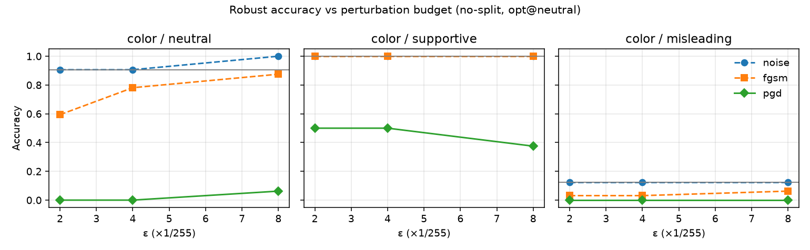
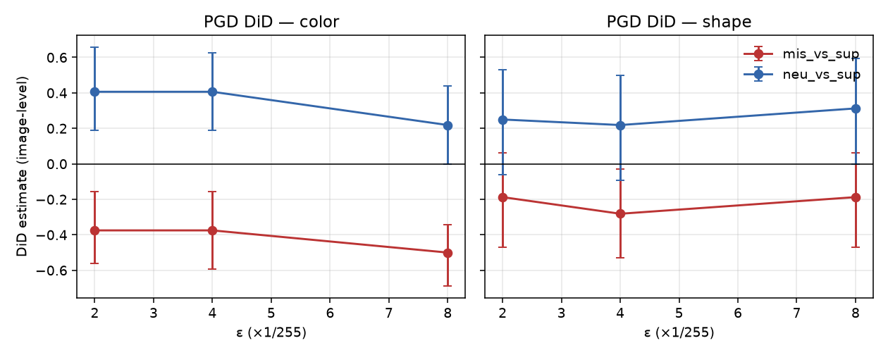

# Cross-modal text context and L∞ image attacks on SmolVLM2: a controlled synthetic study

**Authors / project:** Federico Cavaletto (study owner); agent-assisted implementation under Checkpoint 0–1 protocol  
**Experimental tip (Phase E complete):** `f3dd0bb` on `cursor/phase-e-prep-dabf`  
**Documentation tip:** `cursor/phase-f-docs-dabf` (PR #8)  
**Report date:** 2026-11-06 (Phase F / Study 1 documentation)  
**Status:** Methods demonstration on a synthetic geometric domain. **Not** a claim of novel SOTA attack performance or real-world VLM safety rates.

All numeric results below are taken from committed artifacts under `reports/` (especially `phase-d-full64-metrics.json`, `phase-e-heldout-metrics.json`, and the Phase A–E verification logs). Denominators are shown explicitly. No new model inference was run for this report.

---

## Abstract

Do false captions make a small vision–language model *more* fragile to a fixed image attack than true captions? We test that paired contrast on a 96-image synthetic color/shape dataset (64 development, 32 sealed held-out) with SmolVLM2-500M under no image splitting on MPS. Each perturbation is optimized by ascending teacher-forced **mean** answer NLL under a **neutral** prompt; the same pixels are then evaluated under neutral, supportive, and misleading text. The **primary** difference-in-differences (DiD)—additional error under misleading minus additional error under supportive—is **negative for color** on both splits (held-out PGD at ε=8/255: −0.500, 95% CI [−0.688, −0.344], n=32). A **misleading-color clean floor** (development 6/64 ≈ 9.4%; held-out 4/32 = 12.5%) dominates identification. A **secondary** DiD (neutral − supportive) is positive for color and shows that context still changes vulnerability; it is **not** a validated defense and may partly reflect answer-copying. Random L∞ noise is near-null; FGSM is weak relative to PGD. The Phase D as-run grid was frozen before held-out evaluation; we report the negative primary result without rewriting the original hypothesis.

---

## 1. Motivation

A VLM does not see pixels alone. It also reads whatever sentence we place next to the image. If that sentence conflicts with the figure, an obvious worry is that the model becomes easier to push off the correct answer with a small pixel change. The worry is easy to overstate: “easier” has to mean *relative to a truthful sentence*, under the *same* visual attack—not merely that attacks exist, and not that a caption is a product defense.

This repository is a controlled probe of that paired question, motivated by the AI4I / Politecnico di Torino PhD topic on adversarial robustness in multimodal foundation models. The aim is methodological clarity on hardware we can actually run (Apple Silicon M4, 24 GB, PyTorch MPS): an explicit threat model, a freeze-then-held-out discipline, and room for a negative primary result.

---

## 2. Background and related work

### 2.1 Primary sources (verified citations)

| Work | What it studies | How this study differs |
| --- | --- | --- |
| Goodfellow et al., ICLR 2015 (FGSM) | One-step L∞ signed-gradient attacks on classifiers | We use FGSM only as a **control** on a VLM answer-NLL objective with paired text contexts |
| Madry et al., ICLR 2018 (PGD) | Multi-step projected gradient adversary / adversarial training | Same L∞ PGD *geometry*; here ascent is on **teacher-forced mean answer NLL** of a frozen VLM, not classifier CE with AT |
| Cui et al., CVPR 2024 | Robustness of large multimodal models to **image** adversarial attacks | We fix a small open VLM + **synthetic** paired N/S/M text and estimate a **context DiD**, not broad LMM robustness leaderboards |
| Bhagwatkar et al., Findings of EMNLP 2024 | Architecture and **prompt design** for VLM adversarial robustness | We do **not** redesign architecture or search prompts; prompts are frozen; text is an experimental factor, not a defense recipe |
| Xie et al., CVPR 2025 (Chain of Attack) | Transfer-based attacks / robustness of VLMs | We study **white-box** attacks on the evaluation model only; no transfer / black-box chain |

Classic white-box L∞ attacks (FGSM, PGD) supply the pixel threat model. Multimodal robustness papers above motivate *why* image attacks on VLMs matter. Our contribution is narrower and methodological: a **paired-context DiD** under a frozen no-split SmolVLM2 stack on sealed synthetic splits, with explicit negative-result reporting.

**What this paper is not:** a new attack algorithm, a large-scale benchmark, a transfer-attack study, or a claim that supportive captions are a deployed defense.

---

## 3. Questions and hypotheses

### 3.1 Original research question (unchanged)

On simple labeled images, does *misleading textual context* amplify a small VLM’s susceptibility to adversarial image perturbations, relative to *truthful* (supportive) textual context?

### 3.2 Analysis hierarchy (frozen Checkpoint 1; D1(c))

| Role | Contrast | Status |
| --- | --- | --- |
| **Primary** | misleading − supportive DiD on additional error | Preregistered-style primary; report even if negative / floor-dominated |
| **Secondary** | neutral − supportive DiD | Strongest secondary signal on development; **not** a validated defense |
| Diagnostics | ASR, invalid rates, bounds, noise/FGSM controls, NLL margins | Required reporting; not substitutes for primary |

**Important chronology (honest):** The primary/secondary hierarchy was **frozen after Phase D development review** and **before held-out evaluation**. It was **not** independently preregistered before all exploration. Development results informed the freeze; held-out is confirmatory. We do **not** retrospectively rewrite the original amplification hypothesis because the primary DiD came out negative.

---

## 4. Threat model

| Role | Specification |
| --- | --- |
| Model | Frozen `HuggingFaceTB/SmolVLM2-500M-Video-Instruct` @ revision `7b375e1b73b11138ff12fe22c8f2822d8fe03467` |
| Defender | Weights not updated; input-space attacks only |
| Task | 4-way color or 4-way shape of one large central figure |
| Image adversary | L∞ ≤ ε in RGB `[0,1]`; white-box gradients on the evaluation model |
| Text adversary | False descriptive context sentence (misleading); not jailbreaks |
| Attack use | Craft under **neutral** prompt; evaluate same pixels under N/S/M |

---

## 5. Experimental design

### 5.1 Dataset

- `synthetic_v1`: 96 × 256×256 PNG images (Pillow); 4 colors × 4 shapes × 6 variants.
- Development: 64 images (variants 0–3). Held-out test: 32 images (variants 4–5), sealed until Checkpoint 1 freeze.
- Manifest: `data/synthetic_v1/manifest.jsonl` with per-file SHA-256.
- Generator seed: **20261105**.

### 5.2 Prompts and parser (immutable after freeze)

Neutral / supportive / misleading context sentences; fixed color and shape questions (see `docs/PROTOCOL.md` §6). Strict exact-match parser; invalid → error.

### 5.3 Preprocess

`do_image_splitting=False` (required for feasible MPS backward on 24 GB). Attack on float CHW `[0,1]`; eval via uint8 PIL round-trip. Leading-space BPE answer tokens for the NLL objective (e.g. `Ġred`).

### 5.4 Frozen attack grid (D2 — Phase D as-run)

ε ∈ {2/255, 4/255, 8/255}; PGD 7 steps, α=ε/4, no random start; FGSM; uniform L∞ noise; optimize @ neutral; seed **20261105**.

### 5.5 Software / hardware

Python 3.12.14; torch 2.15.0; torchvision 0.29.2; transformers 5.22.1; device MPS (MacBook Air M4, 24 GB). Generation: `do_sample=False`, `max_new_tokens=12`.

---

## 6. Mathematical definitions (with worked example)

### 6.1 L∞ ball

For clean image \(x \in [0,1]^{C\times H\times W}\) and budget \(\varepsilon\),

\[
\|x^{\mathrm{adv}}-x\|_\infty \le \varepsilon,\qquad x^{\mathrm{adv}}\in[0,1]^{C\times H\times W}.
\]

### 6.2 Teacher-forced answer NLL (attack objective)

Let \(y^\star\) be the correct label string tokenized with leading-space BPE pieces \(t_1,\ldots,t_L\) as emitted after `Assistant:`. With multimodal context \(c\) (image + prompt), the implementation returns HuggingFace’s standard causal-LM loss on answer positions only (prompt tokens masked with `labels=-100`): the **mean** token NLL

\[
\mathcal{L}(x;c,y^\star)=-\frac{1}{L}\sum_{\ell=1}^{L}\log p_\theta(t_\ell\mid t_{<\ell},c(x)).
\]

This matches `teacher_forced_nll` → `model(..., labels=...).loss` in `crossmodal_robustness.gradient_gate` (docstring: “Mean NLL of the answer token sequence”). It is **not** a sum over tokens. For single-token labels (e.g. `Ġred`), mean and sum coincide; for multi-token labels (e.g. some shape spellings), the mean scales the scalar by \(1/L\). Sign(\(\nabla_x\mathcal{L}\)) for FGSM/PGD is unchanged by a positive constant factor, so the mean-vs-sum distinction does not change the attack update geometry, but reported NLL magnitudes must be read as **per-token averages**.

Attacks **ascend** \(\mathcal{L}\) w.r.t. \(x\) (make the correct answer less likely under teacher forcing).

### 6.3 FGSM / PGD

**FGSM** (one step): \(x \leftarrow \mathrm{clip}_{[0,1]}\big(x+\varepsilon\cdot\mathrm{sign}(\nabla_x\mathcal{L})\big)\).

**PGD** (projected gradient ascent), \(K=7\), step \(\alpha=\varepsilon/4\), no random start:

\[
x^{k+1}=\Pi_{B_\infty(x,\varepsilon)\cap[0,1]}\big(x^{k}+\alpha\cdot\mathrm{sign}(\nabla_{x^k}\mathcal{L})\big).
\]

**Noise control:** \(x^{\mathrm{adv}}=\mathrm{clip}_{[0,1]}(x+\delta)\), \(\delta\sim\mathrm{Unif}[-\varepsilon,\varepsilon]^{C\times H\times W}\) (stable MD5-derived seeds at Phase E; see §10).

### 6.4 Error, ASR, additional error, DiD

For image \(i\), condition \(c\in\{\mathrm{neu},\mathrm{sup},\mathrm{mis}\}\):

\[
e_{i,c}^{\mathrm{clean}},\; e_{i,c}^{\mathrm{adv}}\in\{0,1\}
\]

(1 if incorrect or invalid under the strict parser).

**Conditional ASR** (among clean-correct): among \(i\) with \(e_{i,c}^{\mathrm{clean}}=0\), fraction with \(e_{i,c}^{\mathrm{adv}}=1\).

**Additional error:** \(\Delta_{i,c}=e_{i,c}^{\mathrm{adv}}-e_{i,c}^{\mathrm{clean}}\).

**Primary DiD:**

\[
\widehat{\mathrm{DiD}}_{\mathrm{mis-sup}}=\frac{1}{n}\sum_i\big(\Delta_{i,\mathrm{mis}}-\Delta_{i,\mathrm{sup}}\big).
\]

**Secondary DiD:** same with \(\mathrm{neu}\) instead of \(\mathrm{mis}\).

**Image bootstrap:** resample images with replacement, \(B=2000\), seed `20261105`, percentile 2.5/97.5 CI. Tasks analyzed separately.

### 6.5 Worked single-image example (held-out, existing predictions)

From committed `reports/artifacts/phase_e_heldout_predictions_compact.jsonl` (derived from the held-out JSONL; no new inference), image `item_004`, task **color**, PGD \(\varepsilon=8/255\):

| Condition | Clean parsed | Adv parsed | \(e^{\mathrm{clean}}\) | \(e^{\mathrm{adv}}\) | \(\Delta\) |
| --- | --- | --- | --- | --- | --- |
| neutral | red | blue | 0 | 1 | +1 |
| supportive | red | red | 0 | 0 | 0 |
| misleading | green | green | 1 | 1 | 0 |

Primary contribution: \(\Delta_{\mathrm{mis}}-\Delta_{\mathrm{sup}}=0-0=0\).  
Secondary contribution: \(\Delta_{\mathrm{neu}}-\Delta_{\mathrm{sup}}=1-0=1\).

The held-out mean primary DiD is the average of such image-level contributions over all 32 test images (not this single example alone). Bootstrap CIs resample those 32 contributions.

---

## 7. Results

### 7.1 Clean accuracy

| Split | Task | Neutral | Supportive | Misleading |
| --- | --- | --- | --- | --- |
| Development (64) | color | 63/64 (98.4%) | 64/64 (100%) | **6/64 (9.4%)** |
| Development (64) | shape | 48/64 (75.0%) | 64/64 (100%) | 29/64 (45.3%) |
| Held-out (32) | color | 29/32 (90.6%) | 32/32 (100%) | **4/32 (12.5%)** |
| Held-out (32) | shape | 24/32 (75.0%) | 32/32 (100%) | 8/32 (25.0%) |

Clean invalid rate: **0** on both splits. Source: `reports/phase-e-heldout-metrics.json`.

### 7.2 Bounds (held-out attacked rows)

Among 576 attacked rows: before-roundtrip OK rate 1.0; after-roundtrip OK rate 1.0 (`reports/phase-e-heldout-metrics.json#heldout.bounds`). Development Phase D reported the same qualitative compliance on 1152 attacked rows (`reports/phase-d-verification.md`).

### 7.3 Primary DiD (misleading − supportive), PGD

| ε | Task | Held-out estimate [CI95] | Development estimate [CI95] |
| --- | --- | --- | --- |
| 2/255 | color | **−0.375** [−0.562, −0.156] | −0.531 [−0.656, −0.391] |
| 4/255 | color | **−0.375** [−0.594, −0.156] | −0.547 [−0.672, −0.406] |
| 8/255 | color | **−0.500** [−0.688, −0.344] | −0.516 [−0.656, −0.375] |
| 2/255 | shape | −0.188 [−0.469, 0.062] | −0.078 [−0.281, 0.125] |
| 4/255 | shape | −0.281 [−0.531, −0.031] | −0.016 [−0.234, 0.203] |
| 8/255 | shape | −0.188 [−0.469, 0.062] | −0.016 [−0.219, 0.188] |

n_images = 32 (held-out) / 64 (development); n_boot = 2000. Source: `did_side_by_side` in `reports/phase-e-heldout-metrics.json`.

### 7.4 Secondary DiD (neutral − supportive), PGD

| ε | Task | Held-out estimate [CI95] | Development estimate [CI95] |
| --- | --- | --- | --- |
| 2/255 | color | **0.406** [0.188, 0.656] | 0.359 [0.250, 0.500] |
| 4/255 | color | **0.406** [0.188, 0.625] | 0.297 [0.172, 0.422] |
| 8/255 | color | **0.219** [0.000, 0.438] | 0.375 [0.250, 0.500] |
| 2/255 | shape | 0.250 [−0.062, 0.531] | 0.219 [0.016, 0.406] |
| 4/255 | shape | 0.219 [−0.094, 0.500] | 0.281 [0.062, 0.469] |
| 8/255 | shape | 0.312 [0.000, 0.594] | 0.250 [0.047, 0.453] |

### 7.5 Conditional ASR (held-out, PGD; flips among clean-correct)

| ε | Task | Neutral | Supportive | Misleading* |
| --- | --- | --- | --- | --- |
| 8/255 | color | 27/29 = 93.1% | 20/32 = 62.5% | 4/4 = 100% |
| 8/255 | shape | 24/24 = 100% | 14/32 = 43.8% | 8/8 = 100% |

\*Tiny denominators under misleading color — not an amplification readout. Full grid: `reports/phase-e-verification.md`.

### 7.6 Figures

Held-out:

Development counterparts: `reports/figures/phase-d/`.

**How to read the DiD figure:** points above 0 mean more *additional* attack-caused error in the “primary” context of that contrast than in supportive. Primary contrast (mis−sup) below 0 for color is **evidence against** amplification, not for it.

### 7.7 Controls (observation)

Equal-budget noise remains near-null on DiD; FGSM is much weaker than PGD at the same ε (`reports/phase-e-verification.md` §Controls).

---

## 8. Interpretation

Separate what we measured from what we infer and from what remains untested.

**Observations.** Primary DiD for color is negative on development and held-out; the bootstrap CIs exclude 0. Misleading-color clean accuracy is very low on both splits (the floor). Supportive context reduces additional PGD error relative to neutral (secondary DiD > 0 for color). PGD already drives neutral ASR near the top of the grid at small ε. Attack success is not always monotone in ε under greedy decoding—for example, held-out color-neutral PGD conditional ASR is 100% at ε=2/255 and 93.1% at ε=8/255.

**Inferences (limited).** On this synthetic benchmark with this attack stack, the data **do not support** the claim that misleading context *amplifies* PGD damage relative to supportive context for color. Context still **changes** vulnerability (secondary contrast), but supportive text restates the true label in a form that matches the answer channel—**answer-copying is a plausible partial mechanism**, not established. Floor effects make primary amplification poorly identifiable for color: there is little room for additional misleading error.

**Untested hypotheses** (not results). Milder ε or fewer steps; optimizing under misleading or supportive prompts; transfer to other VLMs or natural images; whether supportive mitigation survives when the context cannot be copied as an answer token.

---

## 9. Limitations (explicit)

### 9.1 Statistical and design limits

1. **Small \(n\):** held-out DiDs use **32** images per task; development uses **64**. Bootstrap CIs are wide; several shape secondary CIs include 0.  
2. **Multiple comparisons:** we report many ε × task × contrast × attack cells. The freeze hierarchy (primary mis−sup; secondary neu−sup) constrains *interpretation priority*, but it does **not** provide formal multiplicity-adjusted α control. Treat non-primary cells as descriptive.  
3. **Synthetic data only:** Pillow geometric figures; no claim about photographs, charts, or UI screenshots.  
4. **Non-monotonic attack strength:** some held-out ASR / accuracy cells are not monotone in ε (e.g. color-neutral PGD conditional ASR is 100% at ε=2/255 and **93.1%** at ε=8/255). Do not assume larger ε always yields stronger empirical attack success under greedy decoding + strict parser.  
5. **No mechanistic evidence:** we do **not** provide attention maps, representation analyses, or causal interventions that would explain *why* supportive text helps. Answer-copying remains a plausible untested mechanism.

### 9.2 Measurement and process limits

6. Misleading-color floor undermines primary amplification identification.  
7. Supportive context may enable answer copying (limitation, not a proven mechanism).  
8. PGD saturation / weak dose–response on neutral ASR already at ε=2/255.  
9. Shared images across tasks → non-independence across task analyses.  
10. Possible LANCZOS vs BICUBIC preprocess discrepancy (accepted, not tuned).  
11. Strict parser: many PGD failures are invalids.  
12. Opt@neutral only; single primary model.  
13. Phase B bare-token NLL erratum (corrected thereafter).  
14. Noise seeds at Phase E use MD5-stable derivation (distribution preserved; tensors not bit-identical to Phase D noise).  
15. Freeze hierarchy set after development exploration (honest chronology).

---

## 10. Research process notes (mandatory disclosures)

1. **Ġred / leading-space erratum (Phase B→C):** early gradient-gate scoring used bare BPE ids; greedy decoding emits leading-space pieces. Phase C+ use leading-space tokenization only. Phase B NLL magnitudes are not comparable.  
2. **Revision verify hotfix (`d1ef71e`):** first held-out launch aborted before inference because Transformers 5.22.1 omitted `_commit_hash` on this checkpoint. Verification switched to `huggingface_hub.model_info(...).sha` while still loading with `revision=7b375e1b…`. No attack/prompt change.  
3. **Sleep / agent disconnect:** attempt 2 continued in the same process and completed 640/640 rows; no second launch; no retune.  
4. **Pre-test addendum (2026-11-05):** documents MD5-stable noise seeds vs process-unstable `hash()`.

---

## 11. Reproducibility pointers

See `docs/REPRODUCIBILITY.md` and `reports/artifacts/experiment_metadata.json` (checksums of committed metrics and derived compact prediction tables). Raw `results/*.jsonl` are gitignored; when present locally they hash-match the metadata record used to derive compact tables.

Approximate wall times on the recording host: Phase D full-64 ≈ 15853 s; Phase E held-out ≈ 11149 s; peak MPS memory on the order of ~4 GB in Phase D logs.

---

## 12. Future work (untested)

Labeled **untested**: milder-ε appendixendum on development only if explicitly authorized; optimize-under-misleading pilots; cross-model transfer; natural-image extension; defenses that cannot be reduced to answer copying. None of these were run in Phase F.

---

## References

1. I. J. Goodfellow, J. Shlens, and C. Szegedy, *Explaining and Harnessing Adversarial Examples*, ICLR 2015.  
2. A. Madry, A. Makelov, L. Schmidt, D. Tsipras, and A. Vladu, *Towards Deep Learning Models Resistant to Adversarial Attacks*, ICLR 2018.  
3. X. Cui et al., *On the Robustness of Large Multimodal Models Against Image Adversarial Attacks*, CVPR 2024.  
4. R. Bhagwatkar et al., *Improving Adversarial Robustness in Vision-Language Models with Architecture and Prompt Design*, Findings of EMNLP 2024.  
5. Y. Xie et al., *Chain of Attack: On the Robustness of Vision-Language Models Against Transfer-Based Adversarial Attacks*, CVPR 2025.  
6. HuggingFaceTB, *SmolVLM2-500M-Video-Instruct* (model card / weights; revision `7b375e1b73b11138ff12fe22c8f2822d8fe03467` as frozen).

Primary-source differences vs this study are tabulated in §2.1.

---

## Appendix A — Artifact inventory

| Artifact | Role |
| --- | --- |
| `docs/PROTOCOL.md` | Frozen human protocol |
| `docs/freeze-config.md` | Machine-readable pins |
| `docs/pre-test-addendum-2026-11-05.md` | Pre-held-out technical corrections |
| `reports/phase-{a,b,c,d,e}-verification.md` | Immutable experiment logs |
| `reports/phase-d-full64-metrics.json` | Development metrics |
| `reports/phase-e-heldout-metrics.json` | Held-out + side-by-side |
| `reports/artifacts/*` | Checksums + compact prediction tables |
| `reports/figures/phase-{d,e}/` | Plots |
| `python -m crossmodal_robustness.verify_published` | Offline rebuild of main stats from compact tables |

## Appendix B — Consolidation note (editorial)

Recommended final reviewable tip for merge consideration (when Federico decides): **`cursor/phase-f-docs-dabf`** (this Phase F branch), which contains Phase E results documentation plus this report. Open PRs #1–#6 are historical lineage; they should not be merged separately once the tip PR is chosen. This report does **not** merge or close any PR.
